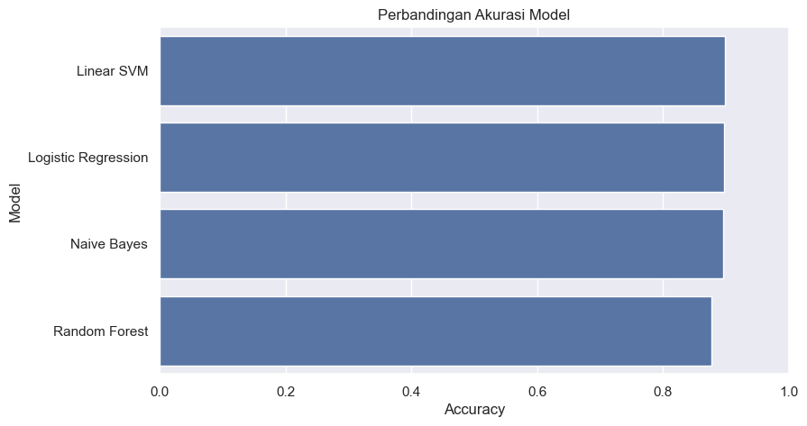
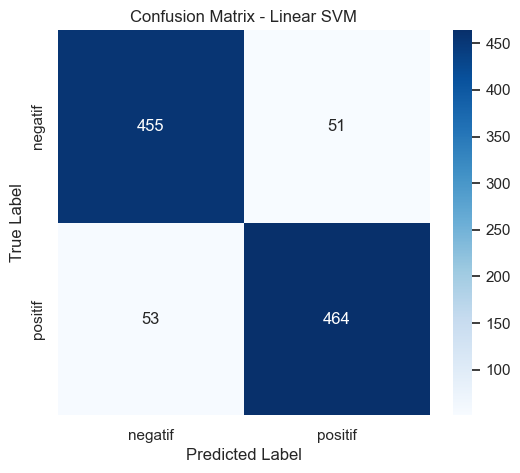

# Gojek Review Sentiment Analysis

An Indonesian NLP project that classifies Gojek app reviews as positive or negative using TF-IDF and classical machine learning, with a tuned Linear SVM recording **90.13% test accuracy**.

**Author:** [Muhammad Akhtar Ariq](https://github.com/AkhtarAriq)

## Project overview

This project explores user feedback on the Gojek Android app through a complete workflow: Google Play review collection, rating-based labeling, Indonesian text preprocessing, feature extraction, model comparison, hyperparameter tuning, and example predictions.

The original notebook records **8,000 reviews**, reduced to **5,113 distinct, nonempty preprocessed samples**. The final dataset contains 2,582 positive and 2,531 negative samples. A stratified 80/20 split produces 4,090 training and 1,023 test samples with `random_state=42`.

## Workflow

1. Collect Indonesian reviews for `com.gojek.app` using `google-play-scraper`.
2. Assign negative labels to 1–2-star reviews and positive labels to 4–5-star reviews; exclude 3-star reviews.
3. Lowercase text; remove URLs, mentions, hashtags, punctuation, and numbers; normalize informal words; remove stopwords; and stem with Sastrawi.
4. Remove empty texts and duplicate preprocessed reviews.
5. Fit TF-IDF inside scikit-learn pipelines and compare four classifiers on the same test split.
6. Tune Linear SVM using an 18-candidate, three-fold `GridSearchCV` on training data.
7. Evaluate predictions and save the selected TF-IDF/classifier pipeline with Joblib.

## Recorded results

These metrics are taken from the notebook's saved outputs; they have not been retrained as part of preparing this repository.

| Model | Test accuracy |
|---|---:|
| Tuned Linear SVM | **90.13%** |
| Linear SVM | 89.83% |
| Logistic Regression | 89.74% |
| Multinomial Naive Bayes | 89.64% |
| Random Forest | 87.68% |

The tuned SVM uses `C=0.1`, 5,000 maximum TF-IDF features, and unigrams. Its recorded mean cross-validation accuracy is **88.24%**. The initial comparison uses unigram/bigram TF-IDF features with a maximum of 10,000 features.



The confusion matrix below belongs to the **untuned Linear SVM (89.83%)**, evaluated before the tuning section. The tuned model's classification report is available in the notebook.



## Technologies

| Purpose | Technology |
|---|---|
| Language and environment | Python, Jupyter Notebook |
| Review collection | google-play-scraper |
| Data processing | pandas, NumPy, Python regular expressions |
| Indonesian NLP | Sastrawi, custom word normalization and stopwords |
| Feature extraction and modeling | scikit-learn, TF-IDF, MultinomialNB, LogisticRegression, LinearSVC, RandomForestClassifier |
| Evaluation and tuning | Stratified train/test split, GridSearchCV, accuracy, classification reports, confusion matrix |
| Visualization | Matplotlib, Seaborn |
| Model serialization | Joblib |

`requirements.txt` preserves the original pinned dependencies. It also includes WordCloud, although the current notebook does not generate a word cloud.

## Run locally

The saved notebook metadata records Python **3.12.4**. Python 3.12 is the recommended starting environment for the existing dependency pins.

```bash
python -m venv .venv
```

Activate the environment:

```powershell
# Windows PowerShell
.\.venv\Scripts\Activate.ps1
```

```bash
# macOS / Linux
source .venv/bin/activate
```

Install dependencies and collect a local dataset:

```bash
python -m pip install -r requirements.txt
python scraping_gojek_reviews.py
jupyter notebook gojek_sentiment_analysis.ipynb
```

Run the notebook cells in order. Scraping requires internet access and requests the latest 8,000 Indonesian reviews; the returned sample and results can change. The scraper overwrites `gojek_reviews_raw.csv`, so keep a separate local copy if you need to retain an earlier collection. Preprocessing and model tuning may take time.

### Dataset and generated files

The raw review CSV is excluded from Git because it contains reviewer identifiers, profile links, and developer replies. Individual-review preview outputs have also been removed from the published notebook. Aggregate charts, reports, and example predictions remain available for review without collecting data.

Running the notebook produces these local files, which are also ignored:

- `gojek_reviews_clean_labeled.csv`: cleaned and labeled reviews.
- `model_sentimen_gojek.pkl`: the selected TF-IDF/classifier pipeline.

The serialized pipeline accepts **already preprocessed text**. Use the notebook's `predict_sentiment()` function, which applies `preprocess_text()` first, for raw-text predictions. The text preprocessing function is not bundled inside the serialized pipeline.

## Repository contents

```text
gojek_sentiment_analysis.ipynb    Analysis, modeling, saved results, and predictions
scraping_gojek_reviews.py        Google Play review collection script
requirements.txt                Original pinned Python dependencies
assets/                         Charts exported from saved notebook outputs
PORTFOLIO.md                    Reusable summary and recommended portfolio outputs
```

## Portfolio highlights

Show the model comparison chart, the clearly labeled baseline SVM confusion matrix, the tuned model's 90.13% result and classification report, the Indonesian preprocessing workflow, and the four example sentiment predictions. Supporting dataset charts are available in `assets/`.

See [PORTFOLIO.md](PORTFOLIO.md) for ready-to-use project copy and a showcase checklist.

## Interpretation and limitations

- Labels are derived from star ratings rather than human sentiment annotations. Accuracy measures agreement with those proxy labels on this dataset.
- The project performs binary classification and excludes neutral/3-star reviews.
- Model comparisons and the tuned result use the same random test split. A separate final holdout or temporal evaluation would provide stronger evidence of generalization.
- The scraper collects recent reviews, so this sample is not necessarily representative of all Gojek users.
- This is a notebook-based analysis and prediction demonstration; it does not include a deployed application or API.
